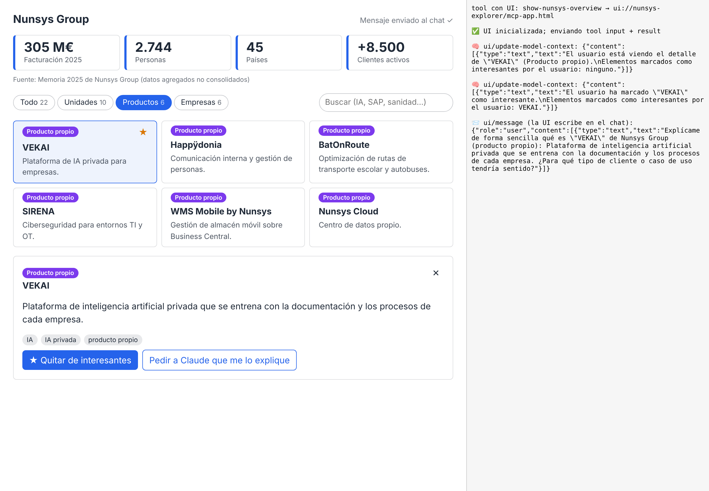

# MCP Apps POC – Explorador Nunsys Group

POC de [MCP Apps](https://modelcontextprotocol.io/extensions/apps/overview): un servidor MCP
cuyo tool, en lugar de devolver solo texto, devuelve **una UI HTML interactiva** que el host
(Claude Desktop, claude.ai, VS Code Copilot…) pinta dentro del chat.


*(Captura con el host de pruebas de `test/`: a la izquierda la app, a la derecha lo que el host recibe.)*

> Los datos son de ejemplo, tomados de la información pública de la Memoria 2025 de Nunsys Group.
> La POC no se conecta a ningún sistema; lo que demuestra es el mecanismo de MCP Apps.

## Cómo funciona (en 30 segundos)

1. El tool `show-nunsys-overview` declara `_meta.ui.resourceUri = "ui://nunsys-explorer/mcp-app.html"`.
2. El servidor expone ese recurso `ui://…` con mimeType `text/html;profile=mcp-app` (el HTML va
   empaquetado en un único fichero con Vite).
3. Cuando Claude llama al tool, el host descarga el HTML, lo pinta en un **iframe sandbox** y le
   pasa el resultado del tool.
4. La UI habla con el host por `postMessage` usando la clase `App` de `@modelcontextprotocol/ext-apps`:

| Acción en la UI | API | Qué pasa |
|---|---|---|
| Carga inicial | `app.ontoolresult` | Pinta las cifras y las tarjetas con el resultado del tool |
| Filtros y buscador | `app.callServerTool("show-nunsys-overview")` | La UI llama al servidor sin pasar por el modelo |
| Clic en una tarjeta | `app.callServerTool("get-item-detail")` | Tool **solo-app** (`visibility: ["app"]`), el modelo no lo ve |
| Marcar como interesante | `callServerTool("toggle-shortlist")` + `app.updateModelContext()` | Cambia el dato y le cuenta al modelo qué ha marcado el usuario |
| "Pedir a Claude que me lo explique" | `app.sendMessage()` | La UI escribe un mensaje en el chat |
| Tema claro/oscuro | `app.onhostcontextchanged` | Usa los estilos del host |

Explicación sencilla para presentarlo: [docs/PRESENTACION.md](docs/PRESENTACION.md) · Diseño técnico: [docs/PLAN.md](docs/PLAN.md).

## Estructura

```
Dockerfile         imagen multi-stage (build + runtime, usuario no-root, healthcheck)
docker-compose.yml servicio mcp (+ túnel cloudflared opcional, profile "tunnel")
scripts/deploy.sh  (opcional) wrapper de docker compose con espera al healthcheck
main.ts            arranque: HTTP (:3001/mcp) o --stdio
server.ts          tools + recurso UI
src/data.ts        datos de ejemplo (info pública de la Memoria 2025 de Nunsys Group)
mcp-app.html       HTML de la UI
src/mcp-app.ts     lógica de la UI (clase App)
src/*.css          estilos
test/host.*        host mínimo de pruebas en el navegador (AppBridge)
```

## 🚀 Despliegue con Docker en WSL (recomendado)

Requisito: Docker disponible dentro de WSL (Docker Desktop con *WSL integration* activada, o
`docker-ce` instalado en la distro). No hace falta Node en el host.

```bash
# dentro de WSL
cd /ruta/a/mcp-apps-poc      # p. ej. /mnt/c/Users/<usuario>/Downloads/mcp-apps-poc
docker compose up -d        # construye la imagen y arranca → http://localhost:3001/mcp
```

Y ya. Cada `docker compose up -d` reconstruye la imagen con el código actual (`pull_policy: build`).

| Comando | Qué hace |
|---|---|
| `docker compose up -d` | Construye y arranca el servidor |
| `docker compose ps` | Estado (debe salir `healthy`) |
| `docker compose logs -f mcp` | Logs del servidor |
| `docker compose down` | Para y borra el contenedor |
| `docker compose --profile tunnel up -d` | Además levanta un túnel público (URL en `docker compose logs tunnel`) |
| `PORT=4000 docker compose up -d` | Publicarlo en otro puerto del host |

WSL2 reenvía `localhost` a Windows, así que desde Windows también funciona `http://localhost:3001/mcp`.

> Opcional: `./scripts/deploy.sh [--tunnel|--down]` hace lo mismo y además espera al healthcheck e
> imprime la URL del túnel.

### Conectar Claude al contenedor

**Claude Desktop (stdio a través de Docker).** En **Settings → Developer → Edit Config**:

```json
{
  "mcpServers": {
    "mcp-apps-poc": {
      "command": "wsl",
      "args": ["docker", "run", "-i", "--rm", "mcp-apps-poc", "node", "build/main.js", "--stdio"]
    }
  }
}
```

(Si usas Docker Desktop, también vale `"command": "docker"` con los mismos args sin `"docker"`.)
Necesita la imagen construida (`docker compose up -d` una vez). Reinicia Claude
Desktop del todo y pide en un chat nuevo: *"Enséñame qué hace Nunsys"*.

**Claude web / Desktop como custom connector (HTTP).** `docker compose --profile tunnel up -d`, busca la URL en
`docker compose logs tunnel` y usa `https://xxxx.trycloudflare.com/mcp` y añádela en **Settings → Connectors → Add custom connector**.

---

## Desarrollo local sin Docker

Requisito: Node.js 20+.

```powershell
npm install
npm run build        # typecheck + UI (dist/mcp-app.html) + servidor (build/*.js)
```

### Claude Desktop con Node local (stdio)

1. Claude Desktop → **Settings → Developer → Edit Config** (abre
   `%APPDATA%\Claude\claude_desktop_config.json`).
2. Añade el servidor (ajusta la ruta si mueves la carpeta):

```json
{
  "mcpServers": {
    "mcp-apps-poc": {
      "command": "node",
      "args": ["C:\\ruta\\a\\mcp-apps-poc\\build\\main.js", "--stdio"]
    }
  }
}
```

3. Cierra Claude Desktop del todo (también desde la bandeja del sistema) y vuelve a abrirlo.
4. En un chat nuevo: **"Enséñame qué hace Nunsys"** → debería aparecer el explorador.

### Custom connector con Node local (HTTP)

```powershell
npm run serve                                    # http://localhost:3001/mcp
npx cloudflared tunnel --url http://localhost:3001   # en otra terminal
```

Copia la URL `https://xxxx.trycloudflare.com`, y en Claude: **Settings → Connectors → Add custom
connector** con `https://xxxx.trycloudflare.com/mcp`. (Requiere plan de pago.)

### Host de pruebas local (sin Claude)

```powershell
npm run serve        # terminal 1
npm run test:host    # terminal 2 → abre http://localhost:5173/test/host.html
```

Pinta la app en un iframe y muestra en el panel derecho los mensajes que la UI manda al host
(`ui/message`, `ui/update-model-context`). Sirve para depurar sin depender de Claude.

### Modo watch

`npm run dev` recompila la UI y reinicia el servidor HTTP al guardar.
Los datos están en memoria: al reiniciar el servidor vuelven a su estado inicial.

## Siguientes pasos posibles

- Sustituir `src/data.ts` por datos reales (API interna, CRM, catálogo de servicios…).
- Auth en el endpoint HTTP antes de exponerlo fuera de local.
- Probar en otros hosts compatibles (VS Code Copilot, Goose, Postman, MCPJam).

## Autor

Alexey Omelchuk – [github.com/alexey-omelchuk](https://github.com/alexey-omelchuk)
