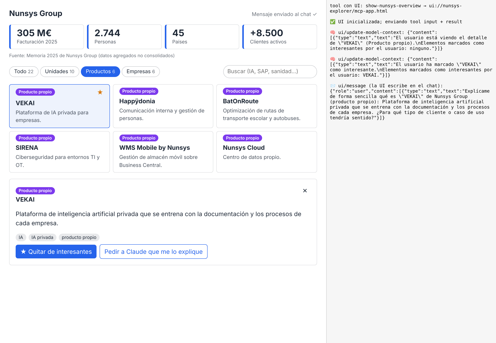
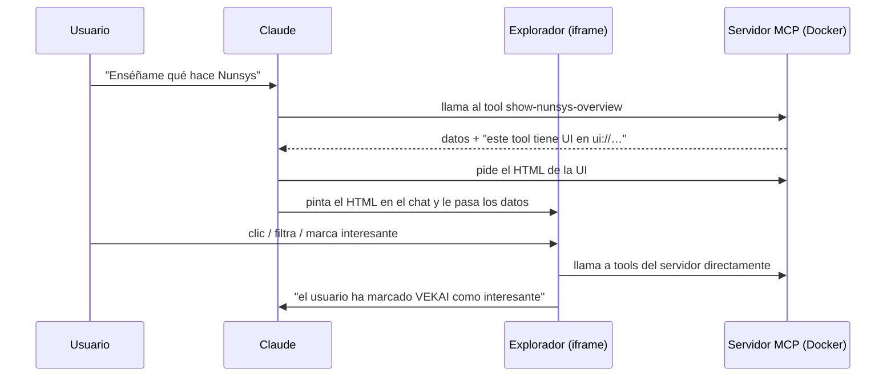

# MCP Apps – explicación para la presentación

## 1. El problema
Hasta ahora un servidor MCP solo podía devolverle **texto** a Claude. Si pides "enséñame qué hace
Nunsys", te llega una lista larga en texto que tienes que leer, y para filtrar, ver un detalle
o marcar algo tienes que volver a escribirle a Claude.

## 2. La idea de MCP Apps
**MCP Apps** es una extensión oficial de MCP que permite que el servidor devuelva **una pequeña
aplicación web (HTML)** que se pinta **dentro del chat**. El usuario hace clic, filtra o rellena
formularios, y todo sigue conectado con Claude y con el servidor.

> En una frase: **el MCP deja de responder solo con texto y pasa a responder con una interfaz.**

## 3. Qué hemos construido (la POC)
Un servidor MCP con un **explorador de Nunsys Group** (datos públicos de la Memoria 2025, solo de ejemplo):

- Cifras clave: facturación, personas, países y clientes.
- Tarjetas de unidades de negocio, productos propios (VEKAI, Happÿdonia, BatOnRoute…) y empresas del grupo.
- Filtros por categoría y buscador.
- Clic en una tarjeta → detalle.
- "Marcar como interesante" → Claude se entera de lo que has marcado.
- Botón "Pedir a Claude que me lo explique" → escribe la pregunta en el chat por ti.

El tema es lo de menos: lo que se demuestra es el mecanismo, que sirve para cualquier dato.



## 4. Cómo funciona, paso a paso



Las piezas clave son solo **dos**, unidas por una dirección `ui://`:

1. **Un tool** (`show-nunsys-overview`) que, además de los datos, dice *"tengo una interfaz en
   `ui://nunsys-explorer/mcp-app.html`"*.
2. **Un recurso** en esa dirección que devuelve el HTML de la interfaz.

Cuando Claude llama al tool, ve esa marca, descarga el HTML y lo muestra en el chat.

## 5. Cómo habla la interfaz con el resto
La interfaz usa una librería oficial (`@modelcontextprotocol/ext-apps`) con 4 acciones básicas:

| La interfaz puede… | Ejemplo en la POC |
|---|---|
| **Recibir** el resultado del tool | Pinta la tabla al abrirse |
| **Llamar** a tools del servidor | Filtros, buscador, ver detalle, marcar interesante |
| **Informar** a Claude de lo que pasa (sin escribir en el chat) | "El usuario ha marcado VEKAI como interesante" |
| **Escribir** un mensaje en el chat | "Explícame qué es VEKAI y para qué cliente encaja" |

Hay tools que **solo usa la interfaz** (ver detalle, marcar interesante): Claude no los ve, así no
se lía con herramientas que solo tienen sentido al hacer clic.

## 6. Seguridad
- La interfaz corre en un **iframe aislado (sandbox)**: no puede leer el resto de la página,
  ni cookies, ni salirse de su caja.
- Toda la comunicación pasa por mensajes controlados por Claude (el "host").
- Si el cliente no soporta MCP Apps, el tool **sigue devolviendo texto**, así que nada se rompe.

## 7. Despliegue
Todo va en un contenedor Docker:

```bash
docker compose up -d      # construye y arranca → http://localhost:3001/mcp
docker compose down       # lo para
```

Para conectarlo a Claude Desktop se añade una entrada en su configuración (ver README) y se
reinicia. Para claude.ai se expone con un túnel y se añade como *custom connector*.

## 8. Dónde funciona
Claude (web y Desktop), VS Code GitHub Copilot, Microsoft 365 Copilot, Goose, Postman, MCPJam…
Es un estándar abierto, no algo exclusivo de un cliente.

## 9. Por qué nos interesa
- **Más visual**: dashboards, formularios, gráficos en lugar de muros de texto.
- **Menos idas y vueltas**: el usuario filtra y actúa con clics, no con mensajes.
- **Claude sigue en el bucle**: sabe lo que hace el usuario y puede ayudar sobre eso.
- **Reutiliza lo que ya tenemos**: es el mismo servidor MCP, solo añade la parte visual.

## 10. Siguientes pasos
Conectar datos reales (escáner, SIEM, Jira…), añadir autenticación y probar otros casos:
aprobaciones, formularios de configuración, informes con gráficos.
